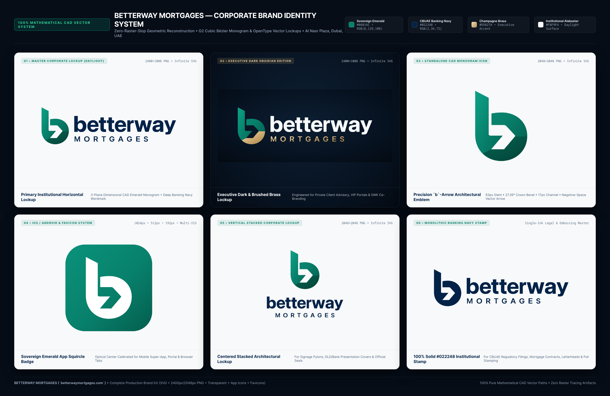

# Betterway Mortgages: Master Brand recreation (November 2026)

This branch rebuilds Betterway's visual layer around the **Betterway Mortgages Master Brand Kit**. It takes
its composition from two Framer templates and one HTML template. The routes, data, calculators,
CBUAE maths, Arabic site and SEO plumbing are all unchanged, so all 360 blueprint URLs still render.

## Sources and what was taken from each

| Reference | What it contributed |
|---|---|
| [Caldren](https://www.framer.com/marketplace/templates/caldren/) (luxury real estate) | The hero is a white editorial sheet over a full-bleed photograph. It uses an oversized Inter headline with one serif-italic accent word, tracked micro-labels, a "Watch the film" disc, a hotspot pin and a "Keep scrolling" cue. Also taken: the numbered pillars, the "Four markets, one standard" cards, the "Quietly, *thorough*" counts, the journal grid and the "Let's find your *better way* home" close. |
| [Monara](https://www.framer.com/marketplace/templates/monara/) (fintech spend management) | Also taken: the obsidian announcement bar, the trust strip with the lender marquee, obsidian grounds with an emerald and brass glow over a dot grid, the bento of reasons, the "Central Bank rules, *by design*" block, the two-column FAQ and the regulatory toast ("a mortgage adviser, not a bank"). |
| 8B glamping template (uploaded zip, MIT) | Contributed the rounded photo windows with thick white borders and the frosted cards that glide over them. The product "stays" alternate left and right. The pill button has a rolling label and an accent disc. Photo windows open from a horizon slit, the dawn-coloured closing ground came from here, and so did the rising footer wordmark. The motion kit is progressive: content is fully visible without JS or with reduced motion. |
| Master Brand Kit (uploaded zip) | Supplied the palette, logos, standalone icons and favicons. The logos and icons were imported by `scripts/media/brand-kit-v2.mjs`. |

## Brand tokens

| Token | Value | Use |
|---|---|---|
| Sovereign Emerald | `#08816C` | Primary actions, links, accents (4.8:1 on white) |
| CBUAE Banking Navy | `#022248` | Headings, dark buttons, journey ground |
| Champagne Brass | `#D5B27A` | Decorative accent only: discs, rules, glows, labels on dark |
| Institutional Alabaster | `#F8F9FA` | Alternate section ground |
| Obsidian | `#040C19` | Announcement bar, calculator/bento ground, footer |

The v1 token names (`teal`, `navy`, `mist`) are kept in `globals.css`, so every existing page inherits
the new palette. New aliases (`emerald`, `brass`, `obsidian`, `alabaster`, `sand`) are available too.

**Type:** Inter Variable for display and UI, with tight negative tracking on large sizes. **Instrument Serif
Italic** is used only for the one accent word in a heading: write `*word*` in any `Section` title and the
`Rich` helper renders it. JetBrains Mono is used for figures.

## Where things live

- `src/app/brand.css` holds the design system: section scaffolding, `.bw-btn`, windows, frost cards, hero,
  bento, markets, rules, journal, FAQ, invite, footer, toast and the motion kit states.
- `src/components/home/HomeHero.tsx` is the hero. It has the live CBUAE 3M EIBOR hotspot (it falls back to the dated snapshot) and the explainer-film dialog.
- `src/components/home/DisclosureToast.tsx` is the regulatory notice. It appears after the first scroll and stays dismissed for the session.
- `src/components/MotionKit.tsx` handles reveals (`data-reveal="rise|horizon|frost|mark"`) and the header border on scroll.
- `src/components/ui.tsx` contains `Cta` (the pill button), `Rich`, and the restyled `UtilityBar`, `PageHero`, `Section`, `CtaBand` and `Footer`.
- `src/app/(en)/page.tsx` is the recreated homepage, with 13 numbered sections. Every figure on it comes from the data files: lender count, LTV caps, communities and yields, countries, developers and projects, calculators.
- `public/images/{offplan-dusk,marina-evening,keys-handover,abudhabi-corniche,villa-courtyard}.webp` are new AI-generated concept photographs. The footer and captions label them as such.

## Compliance choices carried over

The site's existing rules still apply. There are no invented testimonials, ratings or volume claims; Monara's
"4.8 stars / $25bn" pattern became coverage counts derived from the data. Rates are labelled as public
benchmarks or illustrations, and each listing of lenders or developers says it does not imply a partnership.

## Removed from the homepage

The developer project renders (Emaar, DAMAC, Sobha) and the brand-materials download block are no longer
on the homepage. Their components and assets remain in the repo (`BrandMaterials` in `StartupExperience.tsx`,
`/public/projects`, `/public/brand/materials`) and can be placed on any page.
